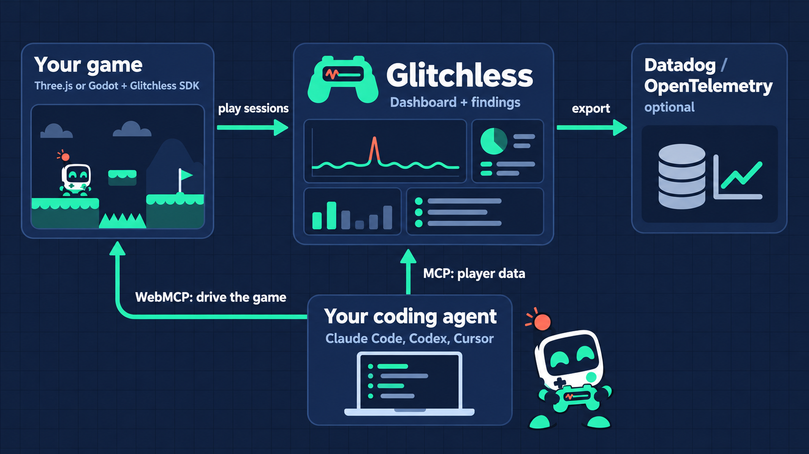
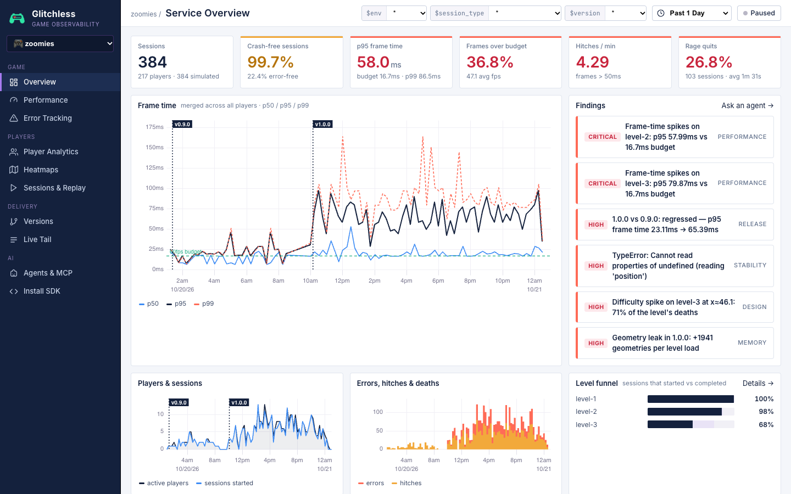

<p align="center">
  <picture>
    <source media="(prefers-color-scheme: dark)" srcset="assets/brand/glitchless/logo/png/glitchless-lockup-dark.png">
    
  </picture>
</p>

# Glitchless

Glitchless shows you how your game plays for real players, and gives your coding agent the same data so it can fix what they hit. It works with Three.js, Phaser, Babylon.js and PlayCanvas games in the browser, and Godot 4.5+, Unity (6.3 LTS and later), Unreal Engine 5.8 and GameMaker (2024.2+) games on phones and desktops.

- **Stutter.** Every frame is timed on every player's device, and each hitch comes with its likely cause: a long script, a shader compile, garbage collection or an asset load.
- **Crashes.** Errors are grouped into issues, each with the gameplay just before it.
- **Where players give up.** Level funnels, death heatmaps and rage-quit detection.
- **What players tell you.** Playtesters press F8 in a web game to send a note with a screenshot, the level and the session behind it (opt-in).
- **Your coding agent.** An MCP server for production data, WebMCP tools exposed by the running game, and autoplay bots that check a fix before it ships.

It's open source and runs anywhere Node runs: one server with a file store, on a laptop, a VPS or in a container. It's anonymous by default ([what it sends](packages/sdk/PRIVACY.md)), and it can pass the same data on to Datadog or any OpenTelemetry backend.

<p align="center">
  
</p>



*The dashboard on simulated history from [`scripts/seed.js`](scripts/seed.js). Also: [performance](docs/screenshots/performance.png) and [death heatmaps](docs/screenshots/heatmaps.png).*

## What's in the box

| Path | What |
| --- | --- |
| [`packages/sdk`](packages/sdk) | `glitchless`: SDK, Three.js, Phaser (3 and 4), Babylon.js and PlayCanvas adapters, overlay, WebMCP tools, Datadog RUM bridge. ~120 KB as one `<script>` (about 38 KB gzipped) |
| [`godot`](godot) | Glitchless for **Godot 4.5+** (`addons/glitchless`): the same events from native Godot games, with errors through Godot's loggers, an anonymous mode and `--glitchless-measure` for agents. A demo game and end-to-end test sit alongside |
| [`unity`](unity) | Glitchless for **Unity 6.3 LTS and later** (`gg.glitchless.sdk`, installed by git URL): frame timing with the player loop split into update, physics and render, profiler counters, errors from Unity's log, scenes as levels, an offline outbox and `--glitchless-measure` for agents. A sample game and end-to-end test sit alongside |
| [`unreal`](unreal) | Glitchless for **Unreal Engine 5.8** (`Plugins/Glitchless`, C++ source): game, render, RHI and GPU times, hitches with their causes (pipeline states created on the spot, garbage collection, map and asset loads), ensures, Blueprint errors and crashes, maps as levels, bug reports, settings that need no code, and `-glitchless-measure` for agents. An optional toolset gives Unreal MCP `Status` and `Measure` tools. A demo with planted problems and an end-to-end test sit alongside |
| [`gamemaker`](gamemaker) | Glitchless for **GameMaker 2024.2+** (GML scripts, a local package or `tools/install.mjs`): frame windows from `delta_time`, hitches named by what GameMaker can see (texture pages, room changes, collections, instance bursts), instance, surface and DS counts for leaks, rooms as levels, crashes sent on the next launch, bug reports and `-glitchless-measure` for agents. A demo with planted problems, a Node test that runs the GML without GameMaker, and an end-to-end test sit alongside |
| [`server`](server) | Intake, query API, findings and alerts: one Node 20+ server with a file store and no npm dependencies (`npm run server`, or the [Docker image](#run-it-on-a-server)) |
| [`apps/dashboard`](apps/dashboard) | The dashboard: Overview, Performance, Error Tracking, Bug Reports, Player Analytics, Heatmaps, Sessions & Replay, Versions, Live Tail, Agents |
| [`apps/zoomies`](apps/zoomies) | **Zoomies!**, a vibe-coded Three.js platformer that ships with four realistic bugs for the demo |
| [`apps/phaser-demo`](apps/phaser-demo) | **Fetch!**, a small Phaser runner (Phaser 3 or 4) with planted bugs, an autoplay bot and a playtest config (`npm run game:phaser`) |
| [`apps/babylon-demo`](apps/babylon-demo) | **Comet Garden**, a small Babylon.js game with planted bugs (a shader per shard, a crash that stops the render loop), an autoplay bot and a playtest config (`npm run game:babylon`) |
| [`apps/playcanvas-demo`](apps/playcanvas-demo) | **Spark Run**, a small PlayCanvas runner with planted bugs (a mesh per spark, a script error), an autoplay bot and a playtest config (`npm run game:playcanvas`) |
| [`packages/mcp`](packages/mcp) | Glitchless MCP server: `glitchless_triage`, `glitchless_performance`, `glitchless_get_error`, `glitchless_death_hotspots`, `glitchless_compare_versions`, `glitchless_bug_reports`, … |
| [`packages/playtest`](packages/playtest) | `glitchless-playtest`: autoplay bots play every change and Glitchless compares it with a saved baseline. Also the `glitchless_playtest` MCP tool |
| [glitchless-deck](https://github.com/glitchless-gg/glitchless-deck) (its own repo) | `glitchless-deck`: send a Godot, Unity, Unreal or web build from macOS, Windows or Linux to a Steam Deck on your network, start it, and measure it there against a saved baseline. Also the `glitchless_deck_send` and `glitchless_deck_measure` MCP tools and the `/glitchless:deck` skill |
| [`packages/sourcemaps`](packages/sourcemaps) | `glitchless-sourcemaps`: a CLI and a Vite plugin that upload a web build's source maps, so errors from minified builds show the original function, file and line |
| [`plugin/glitchless`](plugin/glitchless) | Claude Code plugin: `/glitchless:instrument`, `/glitchless:dashboard`, `/glitchless:triage` and `/glitchless:deck` skills + both MCP servers |
| [`datadog`](datadog) | Datadog dashboard + monitors JSON and a setup script |
| [`scripts/seed.js`](scripts/seed.js) | Simulated player history generated from the game's real level data (tagged `simulated`) |
| [`docs`](docs) | [Technical spec](docs/SPEC.md), [set-up prompt for any coding agent](docs/agent-setup-prompt.md) |

More demos in other genres (an arena shooter, an arcade racer, a tower defense game and a metroidvania), each with
its own events, planted problems, autoplay bot and dashboard, live in their own repo: [**The Glitch Arcade**](https://github.com/glitchless-gg/glitch-arcade).

## Quickstart: paste this into your coding agent

Open your game's folder in Claude Code, Codex, Cursor or any other coding agent and paste the prompt below. It starts a Glitchless server on your machine (with Docker, or Node), adds the SDK for your engine, connects the MCP server and builds a dashboard for your game. It asks you first about anything that needs a line in your privacy policy.

<!-- setup-prompt:start -->
```text
Add Glitchless to this game. Glitchless shows how the game runs and plays for real players: stutters
and what causes them, crashes and errors, the game's own moments (modes, rounds, levels, purchases),
where players get stuck or quit, who comes back, and bug reports players send. Its MCP server lets
you, the coding agent, read that data, fix what players hit and check that the fix worked.

1. Get the Glitchless agent kit, outside this project so it never gets committed:
   git clone --depth 1 https://github.com/glitchless-gg/glitchless ~/.glitchless
   If that folder already exists, run `git -C ~/.glitchless pull` instead.
   If the intake URL in step 2 starts with http://localhost, make sure a local Glitchless server is
   running there: if http://localhost:7777/v1/health answers, use it. Otherwise, with Docker, run
   `docker run -d --name glitchless -p 7777:7777 -v glitchless-data:/data ghcr.io/glitchless-gg/glitchless`
   (or `docker start glitchless` if that container already exists). Without Docker, in ~/.glitchless
   run `npm install && npm run build`, then `npm run server` in the background. The dashboard is at
   the same address.

2. Read ~/.glitchless/plugin/glitchless/skills/instrument/SKILL.md and follow it for this game. It
   covers Three.js (and React Three Fiber), Phaser 3 and 4, Babylon.js, PlayCanvas, Unity 6.3 or
   later, Godot 4.5 or later, Unreal Engine 5.8, and GameMaker 2024.2 or later; for Godot it sends
   you to ~/.glitchless/godot/addons/glitchless/README.md.
   Use these settings:
   - intake URL: http://localhost:7777
   - client token: gl_pub_dev (it's public and can only send data, so it's fine inside the game
     build). On Glitchless Cloud without a token for this game, do the sign-in in step 3 first and
     make the game with the glitchless_create_game tool: it returns the token.
   - privacy: keep the default anonymous mode. Ask me before turning on install mode (what
     retention, D1/D7/D30, needs) or full mode, because either needs a line in the game's privacy
     policy.
   If the game already reports its own analytics or counters, list them for me and send the same
   moments to Glitchless with track(), under the same names. Remove the old reporting only when I
   say so.
   If the game sells anything, send each purchase as track('purchase', { amount, currency, item }),
   so the dashboard can show revenue and conversion.
   Ask me whether players should be able to send bug reports from inside the game (a hotkey or a
   button, with a note and a screenshot). If yes, turn them on as the skill describes; the note is
   whatever the player types, so it needs a line in the privacy policy too.
   For a web game with a production build (Vite or another bundler), also add the source map upload
   the skill describes (glitchless-sourcemaps), so errors from the minified build show the real file
   and line. It uploads with a secret key that can upload source maps, read from GLITCHLESS_API_KEY
   at build time; ask me for one. Skip this while the game sends to a local server.

3. Add two MCP servers to your own MCP settings, in whatever way your tool adds them. For example,
   `claude mcp add` in Claude Code, ~/.codex/config.toml in Codex, or .cursor/mcp.json in Cursor.
   - glitchless: command `npx`, arguments `-y glitchless-mcp`, with the environment variable
     GLITCHLESS_URL=http://localhost:7777. A local server from step 1 needs nothing more. On
     Glitchless Cloud, connect it to my workspace once: run `npx -y glitchless-mcp login` in a
     terminal (or, once the server is loaded, call its glitchless_sign_in tool), show me the link
     and the code it gives, and wait while I approve it. That saves a workspace key that reaches
     every game I have, so name this game in its tools (game: "<the game's name>"). Signed in, you
     can do the rest of this setup yourself with its tools: glitchless_create_game makes a game and
     returns its client token, glitchless_set_dashboard saves its dashboard, and
     glitchless_share_board makes a read-only link to a board. If I'd rather give you a secret key
     for this one game, it's GLITCHLESS_API_KEY in my environment: set that instead. Never put a key
     in the game, in a file that gets committed, or in your reply.
   - webmcp, for a game that runs in a browser (Three.js, Phaser, Babylon.js, PlayCanvas): command
     `npx`, arguments `-y @jason.today/webmcp@latest --mcp`. It lets you drive the running game:
     measure frame times, inspect the scene and reproduce problems. Unity, Godot, Unreal and
     GameMaker builds don't need it: they measure themselves with --glitchless-measure
     (-glitchless-measure in Unreal and GameMaker).
   - For an Unreal game, Epic's Unreal MCP (UE 5.8, Experimental) can sit beside Glitchless: it is
     your hands in the editor (open maps, look inside Blueprints, edit actors, start Play In
     Editor), and Glitchless says what is wrong and whether a change fixed it. If the project uses
     it, or I ask for it, follow the "Agents in the editor: Unreal MCP" part of the instrument
     skill: it adds the Glitchless Toolset plugin, so Unreal MCP can also measure the game in Play
     In Editor. Unreal MCP listens on http://localhost:8000/mcp; the Glitchless server stays on its
     own address.
   If your tool needs a restart to load new MCP servers, tell me.

4. If your tool loads skills from a folder (for example ~/.claude/skills, ~/.codex/skills or the
   project's .agents/skills), copy ~/.glitchless/plugin/glitchless/skills/instrument,
   ~/.glitchless/plugin/glitchless/skills/dashboard and
   ~/.glitchless/plugin/glitchless/skills/triage there. If it doesn't, remember this for later: when
   I ask what's wrong with the game, read ~/.glitchless/plugin/glitchless/skills/triage/SKILL.md and
   follow it; when I ask for a dashboard or for metrics, read
   ~/.glitchless/plugin/glitchless/skills/dashboard/SKILL.md.

5. Check that it works. Run the game, play it or let it run for a minute, then confirm sessions
   arrive: call the glitchless_list_games tool, or ask me to look at http://localhost:7777.

6. Give the game its own dashboard: follow
   ~/.glitchless/plugin/glitchless/skills/dashboard/SKILL.md. Ask me what I want to know about my
   players (where they get stuck, which modes they play, whether they come back, what they buy), add
   the events that answer it, then save pages that fit this game with the glitchless_set_dashboard
   tool (with game set to this game's name if you're signed in to a workspace).

7. Tell me what you changed, file by file, the events you track, and anything you weren't sure
   about. If I use Glitchless Cloud, also tell me I can turn on alerts (Discord, Slack or email) in
   Settings → Alerts, and that you can make a read-only link to any board with
   glitchless_share_board, for a dev log or a "Live stats" button. On my own server, alerts go to a
   Discord or Slack webhook set in GLITCHLESS_ALERT_WEBHOOK.
```
<!-- setup-prompt:end -->

On [Glitchless Cloud](https://app.glitchless.gg), the Get started page gives you the same prompt with your project's address and keys. In Claude Code, the [plugin](#connect-your-coding-agent) does the same in two commands.

## Quickstart by hand

Just the server and dashboard: `docker run -p 7777:7777 -v glitchless-data:/data ghcr.io/glitchless-gg/glitchless`, then open http://localhost:7777. To work on Glitchless or try the demo game:

```bash
npm install
npm run build -w glitchless -w glitchless-dashboard
node scripts/seed.js --reset      # a day of simulated history (optional)
npm run server                    # http://localhost:7777  → dashboard
npm run game                      # http://localhost:5173  → Zoomies (press ` for the overlay)
```

Datadog forwarding switches on automatically when `DD_API_KEY` (or `DATADOG_KEY`) is in `.env`, and OpenTelemetry export when `OTEL_EXPORTER_OTLP_ENDPOINT` is (see [Exporters](#exporters-datadog-or-any-opentelemetry-backend)).

### Add it to your game

```bash
npm install glitchless
```

```js
import * as THREE from 'three';
import { Glitchless, instrumentThree } from 'glitchless';

const glitchless = Glitchless.init({ service: 'my-game', version: '1.0.0', intake: 'http://localhost:7777' });
instrumentThree(glitchless, { renderer, scene, camera, THREE });

glitchless.levelStart('level-1');
glitchless.death({ ...player.position, cause: 'fell' });
glitchless.setContext({ particles, enemies });   // correlated with hitches
glitchless.captureMap('level-1', { axis: 'xy', bounds: { min: [0, -6], max: [180, 12] } });
```

Or ask your agent: `/glitchless:instrument`.

For a Phaser game (3.60+ or 4), hand the game to the Phaser adapter right after you create it. Scenes become levels on their own:

```js
import { Glitchless } from 'glitchless';
import { instrumentPhaser } from 'glitchless/phaser';

const glitchless = Glitchless.init({ service: 'my-game', version: '1.0.0', intake: 'http://localhost:7777' });
const game = new Phaser.Game(config);
instrumentPhaser(glitchless, { game, Phaser });
```

For Babylon.js, hand over the engine and the first scene (a scene with `metadata.level` set is that level); for
PlayCanvas, the app. Both adapters time frames from the engine's own loop and give engine-specific fix advice:

```js
import { instrumentBabylon } from 'glitchless/babylon';
instrumentBabylon(glitchless, { engine, scene, BABYLON });

import { instrumentPlayCanvas } from 'glitchless/playcanvas';
instrumentPlayCanvas(glitchless, { app, pc });
```

For a Godot game, copy [`godot/addons/glitchless`](godot/addons/glitchless) into it, add the `Glitchless` autoload and call `Glitchless.init("my-game", "", "prod", "http://localhost:7777")`. See its [README](godot/addons/glitchless/README.md).

For a Unity game, add the package by git URL (**Package Manager → + → Add package from git URL**):

```
https://github.com/glitchless-gg/glitchless.git?path=unity/Packages/gg.glitchless.sdk
```

then call `Glitchless.Init(new GlitchlessOptions { Service = "my-game", Intake = "http://localhost:7777" })` in the `Awake` of your first scene (`using GlitchlessSdk;`). See its [README](unity/Packages/gg.glitchless.sdk/README.md).

For an Unreal game, copy [`unreal/Plugins/Glitchless`](unreal/Plugins/Glitchless) into the project's `Plugins` folder, enable it in **Edit → Plugins**, and fill in **Service** and **Intake** in **Project Settings → Plugins → Glitchless**; no code is needed. See its [README](unreal/Plugins/Glitchless/README.md), and [`unreal/demo`](unreal/demo) for a small game with planted problems.

For a GameMaker game, run `node gamemaker/tools/install.mjs path/to/Game.yyp` (or import `Glitchless-0.2.0.yymps` from the [release](https://github.com/glitchless-gg/glitchless/releases/tag/glitchless-gamemaker/v0.2.0) with **Tools → Import Local Package**), then call `glitchless_init("my-game", "", "prod", "http://localhost:7777");` in the first room's creation code. See its [README](gamemaker/README.md).

## Connect your coding agent

```bash
# production telemetry + ranked findings
claude mcp add glitchless -e GLITCHLESS_URL=http://localhost:7777 -- npx -y glitchless-mcp
# the live game as a tool server (WebMCP); ask Claude for a token, paste it into the WebMCP widget
claude mcp add webmcp -- npx -y @jason.today/webmcp@latest --mcp
# or both at once, plus the skills
/plugin marketplace add glitchless-gg/glitchless
/plugin install glitchless@glitchless
```

## Playtest every change

Vibe-coded games rarely have tests. Their autoplay bots can stand in: `glitchless-playtest` plays fixed-seed runs in real Chrome on the current code, asks Glitchless for the numbers from exactly those sessions, and compares them with a saved baseline. Add it to your game's project with `npm install -D glitchless-playtest playwright`, then:

```bash
npx glitchless-playtest --save baseline   # before the change
npx glitchless-playtest                   # after it: PASS, or FAIL with what got worse (exit code 1)
npx glitchless-playtest --compare-only baseline latest
```

A metric only counts as worse when it moves past both a relative and an absolute margin (slow frames: +50% and +2 percentage points), so noise on a fast machine doesn't fail a build. The share of slow frames, render CPU, update CPU (the game's own update code, where the SDK can time it, as with Phaser) and draw calls are checked overall and per level; any new error type or crashed run fails too. Frame time p95, hitches, deaths, completion and geometry growth produce warnings. p95 is only a warning because with vsync, frame times cluster at 16.7 and 33.3 ms, so p95 jumps between them when about 5% of frames are slow. A quick run is compared with the matching runs of a full baseline. Scenarios, thresholds and URLs can be overridden in `glitchless.playtest.json`. Runs are saved in `.glitchless/playtest/`.

For your own game, give the playtest URL parameters that start your autoplay bot and an expression that is true when a run is over:

```json
{
  "game": "http://localhost:5173/",
  "scenarios": [
    { "name": "speedrun", "params": { "bot": 1, "seed": 3 }, "max_s": 120 },
    { "name": "careful player", "params": { "bot": 1, "seed": 9, "skill": 0.5 }, "max_s": 120 }
  ],
  "done_when": "window.myGame?.over === true",
  "thresholds": { "draw_calls": { "label": "Draw calls per frame", "higher": true, "pct": 40, "abs": 100, "severity": "warn" } }
}
```

The bots run one at a time, because parallel browsers compete for the GPU and wreck frame times. Compare runs from the same machine. Coding agents get the same check as the `glitchless_playtest` MCP tool, and the triage skill uses it before reporting a fix as done. For CI, [`docs/playtest-github-action.yml`](docs/playtest-github-action.yml) plays the main branch and the pull request on one runner and posts the report on the PR.

## Exporters: Datadog or any OpenTelemetry backend

The server can send every game's telemetry on to other backends. Switch on either, both or neither in `.env`. With neither, nothing leaves the server. `/v1/health` and the dashboard's **Agents & MCP** page show each exporter's status: what it has sent, failures and the last error. Credentials never appear there.

| Exporter | Switch it on | What arrives |
| --- | --- | --- |
| Datadog | `DD_API_KEY` (or `DATADOG_KEY`), `DD_SITE`. `GLITCHLESS_DATADOG=off` turns it off | `glitchless.frame.time` as a distribution metric; gauges and counts tagged `service`, `env`, `version`, `level`, `gpu_tier`, `browser`; logs with `error.*` for Error Tracking; an event for each new version |
| OpenTelemetry (OTLP/HTTP, JSON) | `OTEL_EXPORTER_OTLP_ENDPOINT`, `OTEL_EXPORTER_OTLP_HEADERS`. `GLITCHLESS_OTLP=off` turns it off | `glitchless.frame.time` as an exponential histogram; counters `glitchless.frame.count`, `glitchless.frame.slow`, `glitchless.frame.hitches`, `glitchless.sessions`, `glitchless.level.starts`/`completes`/`fails`, `glitchless.deaths`, `glitchless.errors`; log records for gameplay events and errors |

How Glitchless maps onto OpenTelemetry:

- **Resource:** the game build: `service.name`, `service.version` and `deployment.environment.name`, plus a `service.instance.id` for the Glitchless server process.
- **Metric attributes:** `game.level`, `game.gpu_tier`, `user_agent.name` (the browser, or `godot`, `unity`, `unreal` or `gamemaker`) and `game.session_type`. Deaths add `game.cause` and errors add `error.type`. Sessions aren't metric attributes, because one stream per session would swamp any backend.
- **Log records:** `session.id` and `user.id`, then the event's own fields under `game.*`, with event names like `glitchless.death`. Errors are `ERROR` records with `exception.type`, `exception.message` and `exception.stacktrace`.

The standard variables work as they do in any OpenTelemetry SDK:

- `OTEL_EXPORTER_OTLP_METRICS_ENDPOINT` and `OTEL_EXPORTER_OTLP_LOGS_ENDPOINT` set one signal's endpoint, and only signals with an endpoint are sent.
- `OTEL_METRICS_EXPORTER=none` and `OTEL_LOGS_EXPORTER=none` turn one signal off.
- `OTEL_EXPORTER_OTLP_METRICS_TEMPORALITY_PREFERENCE` is `cumulative` (the default) or `delta`.
- `OTEL_METRIC_EXPORT_INTERVAL` holds metrics for that many ms. Without it, metrics go out after every intake request, so nothing waits in memory.
- `OTEL_RESOURCE_ATTRIBUTES` adds resource attributes.

Glitchless only speaks OTLP/HTTP with JSON bodies, so it needs no OpenTelemetry packages. Not every vendor accepts JSON, so the dependable setup is an [OpenTelemetry Collector](https://opentelemetry.io/docs/collector/) (or Grafana Alloy) next to the server, re-exporting in whatever your backend prefers:

```bash
OTEL_EXPORTER_OTLP_ENDPOINT=http://localhost:4318          # the Collector's OTLP/HTTP receiver
```

Sending straight to a vendor works where its OTLP endpoint takes JSON. Grafana Cloud does, though it recommends JSON only for light traffic. For anyone else, check their docs or try it: a rejected request shows up as a failure on the Agents page.

Datadog's OTLP metrics intake takes JSON, with delta temporality only. Its OTLP logs intake documents protobuf only. The native exporter (`DD_API_KEY`) is still the fuller path into Datadog. Don't point both at the same org, or every `glitchless.*` metric arrives twice. To try metrics over OTLP instead:

```bash
OTEL_EXPORTER_OTLP_METRICS_ENDPOINT=https://otlp.datadoghq.com/v1/metrics   # use your Datadog site's endpoint
OTEL_EXPORTER_OTLP_HEADERS=dd-api-key=YOUR_API_KEY
OTEL_EXPORTER_OTLP_METRICS_TEMPORALITY_PREFERENCE=delta
```

`npm run test:otlp` checks the exporter end to end against a real Collector (`otel/opentelemetry-collector` in Docker, with the debug exporter), or against a small local OTLP receiver when Docker isn't running. The exporters live in [`server/src/exporters`](server/src/exporters). Each takes plain JSON settings, so a hosted server could build them per project from stored settings.

## Alerts in Discord or Slack

Set `GLITCHLESS_ALERT_WEBHOOK` to a Discord or Slack incoming-webhook URL and `npm run server` checks the game every 15 minutes. It posts only when something got worse for real players, by enough to act on today:

- crashes jumped: 5 or more players crashed in the last 6 hours, at least 3 times the usual share for those hours over the last week;
- a new error is spreading: first seen within a day, it has reached 10 players or 5% of sessions;
- a release made it worse: the newest version stutters (2 or more hitches a minute) or crashes for noticeably more players than the one before, with enough players on each that it isn't chance;
- the game went quiet: next to no sessions for 3 hours when those hours usually have 10 or more an hour, and a short note when they're back.

Each message is one plain sentence, such as `zoomies is crashing: 14 players in the last 6 hours (usually about 2 a day). Started with 1.1.1.`, then how many players next to what's normal, what to do, a link to the dashboard page and a line to paste into your coding agent. The measurements behind it (rates, frame times, finding ids) are in a small "For your agent" part at the bottom. Players are counted by the player IDs a game sends, else in sessions, and the message says which. Problems that were already there when the server started don't post, and an alert doesn't repeat while its problem lasts. The state is kept in memory, so a restart starts over. For a Slack-compatible webhook on another host (Mattermost, for one), add `GLITCHLESS_ALERT_FORMAT=slack`. The rules are in [`server/src/alerts.js`](server/src/alerts.js), and [SPEC §3e](docs/SPEC.md) has the numbers. Glitchless Cloud adds Google Play's store limits, the plan's play sessions and a weekly summary.

## Run it on a server

The server is one Node process that keeps its data in files, so anything that runs Node 20+ or a container can host it: a VPS, a home server, Fly.io, Railway or a Raspberry Pi. The Docker image has the server, the dashboard and the browser SDK:

```bash
docker run -d --name glitchless -p 7777:7777 -v glitchless-data:/data \
  -e GLITCHLESS_CLIENT_TOKENS=gl_pub_my_game \
  -e GLITCHLESS_API_KEY=pick-a-long-read-key \
  ghcr.io/glitchless-gg/glitchless
```

Without Docker: `npm install && npm run build -w glitchless -w glitchless-dashboard`, then `npm run server` with `PORT` and `GLITCHLESS_DATA_DIR` set. To build the image yourself, `docker build -t glitchless .` in this folder.

- **Data**: events, level maps, bug reports, source maps and dashboards are files under `/data` (`GLITCHLESS_DATA_DIR`). Back that folder up. The file store reads back the last 14 days.
- **Keys**: games send with a client token from `GLITCHLESS_CLIENT_TOKENS` (public, write-only). On a server others can reach, set `GLITCHLESS_API_KEY`, so the dashboard, the MCP server and deletes need it.
- **HTTPS**: put a proxy in front (Caddy, nginx or your host's), since web games on HTTPS can't send to plain HTTP.
- **Everything else** (exporters, alerts, rate limits) is an environment variable; [`.env.example`](.env.example) lists them.

## How the numbers are computed

- **Frame time.** The SDK infers the display refresh rate (60/120/144 Hz) to set the frame budget. Every 5 s it ships a **DDSketch-style mergeable histogram** (2% relative error). The server merges sketches across players, so global p95s are exact rather than averages of averages. Datadog receives the same data as a **distribution metric**, and OpenTelemetry backends as an **exponential histogram**.
- **Hitches.** A hitch is a frame over 50 ms *and* more than 2× the recent median, so a stutter counts but a slow device doesn't. Each hitch is attributed to a long script (Long Animation Frames API: function plus file), a shader compile (program count changed), GC (heap dropped) or an asset load in flight. It's also tagged with the game-context gauges and the gameplay events in the preceding 1.5 s, ranked by **lift over base rate**.
- **Crash-free (game-aware).** A crash is WebGL context loss with no restore, a frozen frame (>700 ms), or an unhandled error followed by the player leaving within 10 s. *Error-free* sessions are reported separately.
- **Rage quit.** The session ends within 20 s of a death or fail without the player continuing.

See [docs/SPEC.md](docs/SPEC.md) for the wire format.
