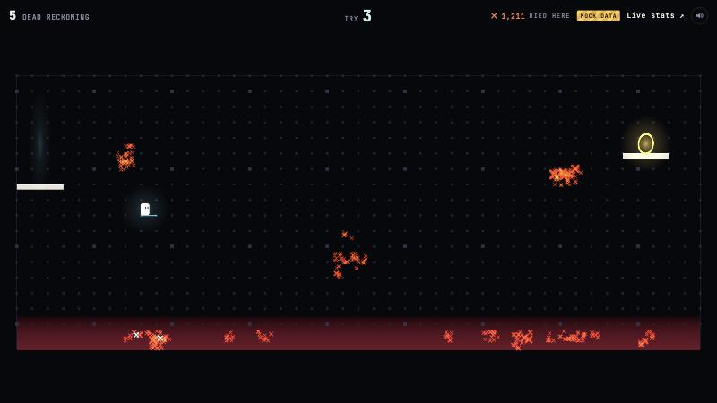
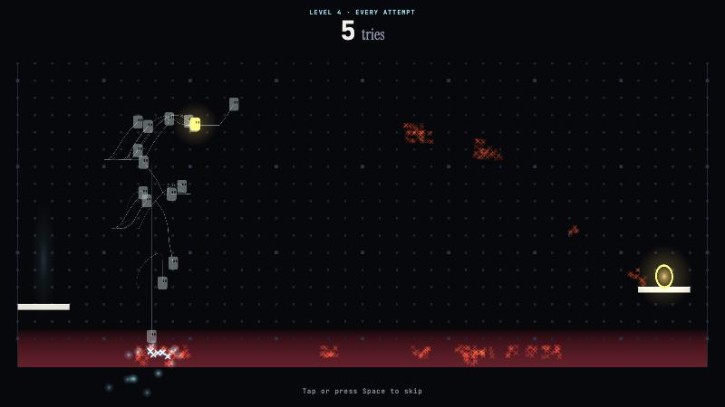
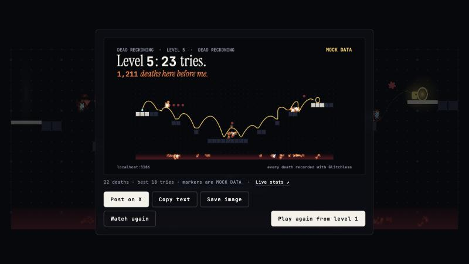
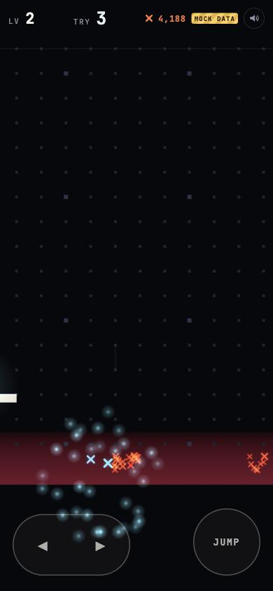

# Dead Reckoning

A precision platformer with invisible platforms. You see the start, the goal and the dead: every death by every
player leaves a glowing mark where they fell. On day one nobody gets far; as people die, the marks draw the way
across. Finish a level and every one of your attempts replays at once, Super Meat Boy style, then you get a card
to post: "Level 3: 47 tries. 3,112 deaths here before me."

It's the second Glitchless launch game: everyone else's marks come from Glitchless, read through a share link, and
the game sends real deaths, levels and positions from the first minute.

| | |
| --- | --- |
|  |  |
| Level 5, third try, standing on a ledge you can't see. Orange: everyone's deaths (mock data here). Blue: yours. | The replay: 21 attempts as ghosts with trails, deaths popping, the gold one is the run that made it. |
|  |  |
| The share card, after the level is revealed. | A phone, 390 px wide, with the thumb pad. |

## Run it

```bash
npm run dev -w dead-reckoning
```

Opens on <http://localhost:5186>. In development the markers are **mock data** (labelled MOCK DATA in the HUD and on
the card) and telemetry goes to a local Glitchless server on port 7777 if one is running (`npm run server`).

Keys: arrows or A/D to move, Space, W or ↑ to jump (hold for higher), R to restart, Esc (or ☰) for the levels, M
for sound. On a phone: the left pad is ◀ and ▶ (slide between them), the right button jumps.

`npm test -w dead-reckoning` checks every level can be beaten, the mock, and the share-link reader against
`test/fixtures/share-board.json`.

Query-string knobs:

| | |
| --- | --- |
| `?level=3` | start on level 3 (and unlock the picker) |
| `?markers=mock`, `none`, a share link, or a `.json` URL | where everyone else's deaths come from |
| `?autoplay=1&skill=0.6&seed=4&speed=4` | the bot plays (below); `speed` > 1 skips replays |
| `?env=prod&intake=…` | where telemetry goes; `?nogd=1` turns it off |
| `?reveal=1` | show the invisible level (for building levels) |
| `?overlay=0` | hide the Glitchless overlay and WebMCP widget in dev |
| `?stay=1` | with autoplay, stop at the share card |
| `?poster=1` | the title alone, for the link-preview picture |

## What it sends to Glitchless

Service `dead-reckoning`, privacy mode `anonymous` with `positions: true`: death places and 4 Hz position samples in
level tiles, coarse device facts, and nothing stored on the device, so the game needs no consent banner. Each page
load is its own session; "players" on a board count sessions. (`install` mode would add a stored player ID, for
returning-player and retention numbers; it's one line in `src/telemetry.js`, and `public/privacy.html` would need a
line about it.)

- `level_start` when you start a level (once, not per try), `level_complete` when you finish it.
- `death({ x, y, z: 0, cause })` at the body's centre in world tiles; `cause` is `fell`, `spikes` or `saw`.
  A fall is recorded as the body drops past the bottom, at about y = -0.6.
- Positions while you play, cleared during the replay and card so the goal doesn't fill the heatmap.
- `track('cleared', { level, tries })` with each clear: a breakdown of `cleared` by `level` with `sum: "tries"`
  gives the tries per level; divided by that level's clears, the average.
- `track('replay', { level, watched, tries })`, `watched` being `full` or `skipped` (the first showing only).
- `track('share', { level, via })`, `via` being `native`, `x`, `copy` or `image`.
- Gauges `markers` and `ghosts`, so a hitch can be pinned on a crowded level or replay.
- A map of each level (the real level, revealed) for the dashboard heatmap, from bot and dev sessions only, so
  thousands of players don't each upload one.

## Where the markers come from

`src/markers/index.js` defines the interface; there are two real implementations and a null one:

- **`mock`** (`src/markers/mock.js`): fake. Seeded autoplay bots play a few hundred attempts per level, a slice at
  a time, binned like a positions panel and scaled to a few thousand. Always labelled MOCK DATA. The default in
  development.
- **share link** (`src/markers/share-link.js`): reads a Glitchless share link to a board with one `positions` panel
  per level. Each panel evaluates to `{ level, axis: 'xy', bounds, bin, deaths: [[x, y, n], …], total, truncated }`.
  Every player fetches the same URL, `GET {api}/v1/query/board?share=<token>&days=30`, about once a minute with
  jitter, not while the tab is hidden. A failed fetch keeps the last markers and shows STALE; a 429 waits for its
  Retry-After. It also accepts the URL of a JSON copy of the same answer.
- **`none`**: no markers but your own. The default in a production build with no link set.

The token goes in `?share=`, not the `x-glitchless-share` header: no CORS preflight, and the URL is the cache key.
The token ends up in the game's bundle, which is fine for a board meant to be public, but put nothing on that board
you wouldn't publish.

A bin's `x, y` is its centre (as the panel defines it), drawn with up to nine X's scattered inside it and brighter
the more it holds.

Checked against the positions-panel branch's own server (in-process, with a share-link reader like Glitchless
Cloud's): bot and player deaths sent per level came back as the same totals, in 0.5-tile bins, with
`Cache-Control: public, max-age=60` and `Access-Control-Allow-Origin: *`.

## Set up (the owner)

1. **The game.** On Glitchless Cloud, the game `dead-reckoning` and its public key (`gl_pub_…`).
2. **The board.** A board page, say `live`, with one `positions` panel per level, plus whatever the public should
   see. With `glitchless_set_dashboard` or the dashboard editor, something like:

   ```json
   { "id": "live", "title": "Dead Reckoning, live", "panels": [
     { "type": "stat", "metric": "sessions", "title": "Plays" },
     { "type": "stat", "metric": "deaths" },
     { "type": "levels" },
     { "type": "positions", "level": "1", "bin": 0.5, "title": "Level 1" },
     { "type": "positions", "level": "2", "bin": 0.5, "title": "Level 2" },
     { "type": "positions", "level": "3", "bin": 0.5, "title": "Level 3" },
     { "type": "positions", "level": "4", "bin": 0.5, "title": "Level 4" },
     { "type": "positions", "level": "5", "bin": 0.5, "title": "Level 5" }
   ] }
   ```

   Levels are the strings `"1"` to `"5"`. `bin: 0.5` (half a tile) keeps each mark where it is as deaths pile up;
   without it the panel picks a bin from the level's size, which changes as the level fills in.
3. **The share link.** Share on that board: no expiry, a rolling window (not pinned), no sums. Copy the
   `https://app.glitchless.gg/#/share/gl_share_…` link (it's shown once).
4. **Deploy** to `https://dead-reckoning.glitchless.gg/` (below) with:

   | variable | value |
   | --- | --- |
   | `VITE_GLITCHLESS_TOKEN` | the game's `gl_pub_…` key (the same name Lagderboard uses) |
   | `VITE_MARKERS` | the share link (or the URL of a JSON copy of the board) |
   | `VITE_LIVE_STATS_URL` | where the "Live stats ↗" links go; defaults to `VITE_MARKERS` when that's a share link. With neither, a production build leaves the links out |
   | `VITE_GAME_URL` | only to host it somewhere else (itch.io): the game's address, for the share text and the link preview. A production build defaults to `https://dead-reckoning.glitchless.gg/` |

   Intake defaults to `https://api.glitchless.gg` and `env` to `prod` in a production build. Without
   `VITE_MARKERS` the game shows only your own deaths.
5. Open it on a phone and a desktop, die a few times, and check the deaths reach the board within a few minutes.
   Post the link in a private X draft or DM to see the link card.

### Hosting

`npm run build -w dead-reckoning` writes a static site to `apps/dead-reckoning/dist/`; any static host will do. Cache
the hashed `assets/` for a year, `og.png` and `privacy.html` for a day and `index.html` for a minute, and set
`VITE_GAME_URL` to the address it will live at, for the link card. Glitchless's own copy runs at
https://dead-reckoning.glitchless.gg/.

Or itch.io, with no AWS at all: `VITE_GAME_URL=<the itch page> npm run build -w dead-reckoning && npm run zip -w
dead-reckoning`, then upload `dead-reckoning-web.zip` as an HTML game ("played in the browser", 1280×720, mobile
friendly, fullscreen button on). itch.io shows its own cover image in link previews.

Source maps (`*.map`) stay off the web in both; upload them to Glitchless instead so errors show the code
(`/v1/sourcemaps`, docs/SPEC.md §3d).

The link preview is `public/og.png` (1200×630), the title screen drawn by the game. After changing the title or
the levels: `npm run dev -w dead-reckoning`, then `npm run og-image -w dead-reckoning`.

### Polling

Every player polls the one URL, and a share link's answer is cacheable for a minute (`Cache-Control: public,
max-age=60`), so on Glitchless Cloud CloudFront answers the crowd and the server makes the board about once a
minute. The per-link rate limit (10 a second per server process, `GLITCHLESS_SHARE_RPS`) only counts answers it
has to make. Marks can be a few minutes behind: a minute in each cache, plus the poll.

## Seeding launch day with bots

`?autoplay=1` plays with a bot that reads the level (players can't) and smudges its timing by `1 - skill`, so it
dies a lot and in the places people do. Its sessions are `session_type: 'synthetic'`, as the playtest bots' are. It
starts at level 1, gives up on a level after 60 deaths, and sets `window.__GLITCHLESS_PLAYTEST_DONE__` when it
quits or beats level 5, so the repo's bot runner drives it as it is:

```bash
node scripts/bots.js --game https://dead-reckoning.glitchless.gg/ --bots 40 --parallel 4 --max 300 --intake https://api.glitchless.gg
```

(`bots.js` adds `env=prod`, a skill from 0.3 to 0.95 and a seed per bot. One bot at skill 0.3 reached level 3 with
8 deaths in 45 s against a local server.)

What I checked, and what it takes for bot deaths to show on launch day:

- **Board panels include bot sessions.** Queries default to every session type (`type=all`, `server/src/app.js`), and
  a share link replaces the request's parameters with its own service, page and window, so no session-type filter
  ever reaches a shared board. On a local server, a board with `deaths` and `stat` panels counted a synthetic
  session's 17 deaths with no `type`, the same with `type=all` and `type=synthetic`, and none with `type=user`.
  The positions panel doesn't filter them either: in-process against its branch, bot and player deaths were both
  counted, with or without `&type=user` on the URL.
- **They're capped, not billed.** Glitchless Cloud counts bot sessions apart and stores up to the plan's included
  number a period (5,000 on Free), then drops further bot sessions. One bot session can die 60 times on a level, so
  that's plenty.
- **Timing.** Raw events are kept 3 days; after that a day keeps at most 100 deaths with coordinates per level, per
  (env, version) (`CAPS.deaths` in `server/src/daily.js`). Run the bots within 3 days of launch, or spread them
  over several days. On Free the board shows 14 days at most (90 on Indie).
- **Be honest about it.** Bot deaths count in the "N deaths here before me" on the card and in the public board's
  stats. The title screen says "Some of the early marks are from our playtest bots" whenever the marks come from a
  share link, and so does the privacy page; say it in the launch post too. For the week-later numbers post, read
  real players' numbers with `type=user` on the private dashboard, not from the public board. If bot and player
  deaths should be counted apart on the card, the positions panel would need to report them apart.

## Files

| | |
| --- | --- |
| `src/levels.js` | the five levels as ASCII (`#` invisible ground, `=` visible, `^ v` spikes, `x` saw, `S`, `G`) |
| `src/physics.js` | fixed 60 Hz tile physics, shared by the game, the bot, the mock and the tests |
| `src/bot.js`, `src/autoplay.js` | the bot (a route graph over the level, then short moves with smudged timing) |
| `src/markers/` | the marker sources and the layer that draws them |
| `src/view.js` | three.js: the chart, pads, goal, player, footstep glows, bursts, the reveal |
| `src/replay.js` | recording attempts and the replay |
| `src/share.js` | the 1200×630 card and the ways to send it |
| `src/main.js` | the loop and the game's states |
| `public/privacy.html` | what the game records, linked from the title |
| `public/og.png`, `scripts/og-image.mjs` | the link-preview picture and how it's made |

Levels are checked by `test/levels.test.js`: the bot at full skill must beat each one. Edit a level, run the tests.

## Decisions made without the owner

- Privacy mode `anonymous` (no stored ID, no consent banner) rather than `install` (returning players, retention).
- Bot-seeded marks are disclosed on the title screen and the privacy page.
- Hosting at `dead-reckoning.glitchless.gg`, like Lagderboard's; nothing is set up or deployed.
- "Live stats" links are left out of a production build until there's a real link (shown in development as a
  placeholder).
- The privacy page is my plain account of what the SDK sends in this mode, not legal advice; read it before launch.

## Not done or not checked

- The share-link path is checked against the positions-panel branch in-process and a fixture, not against
  Glitchless Cloud.
- Phones were checked in Chrome's phone emulation at 390 px (layout, touch pad, multi-touch, no sideways scroll),
  not on a real device. Native sharing (`navigator.share` with the image) only shows on devices that have it.
- Difficulty is tuned with bots, not people. Level 5 is hard on purpose: bots at skill 0.8 beat it within 60 deaths
  in all 12 seeds tried (0 to 22 deaths each); at skill 0.5 one gave up after 60.
- Sound is a few synthesized blips, not listened to.
