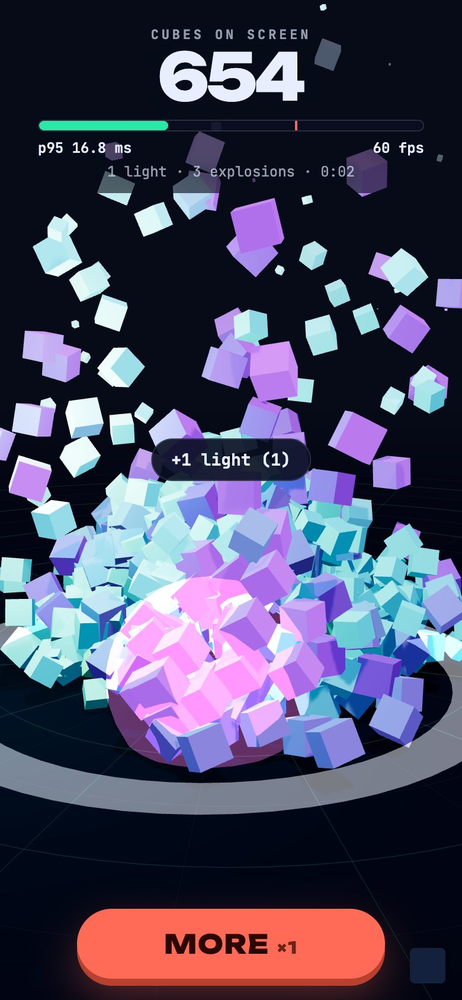
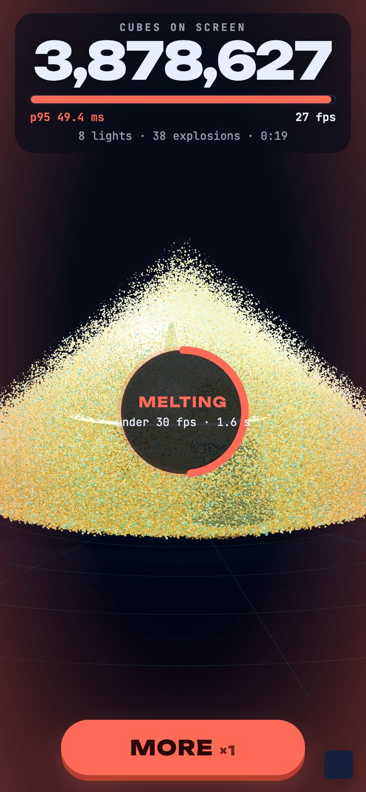
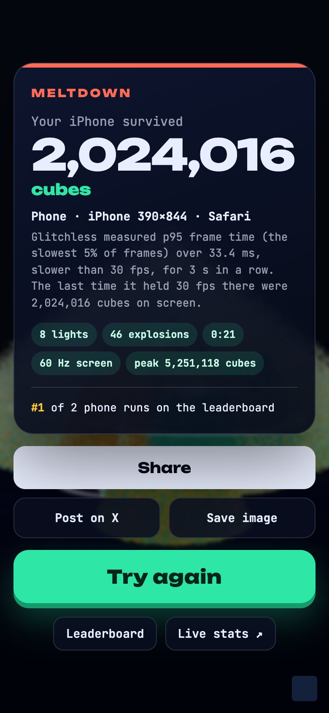
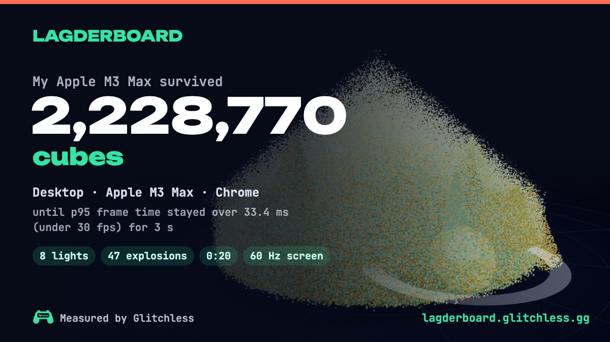

# Lagderboard

How much can your device take? The player keeps piling on cubes, lights and explosions. The run ends when the
frame rate stays under 30 fps for 3 seconds, and the score is what the device held: "My iPhone survived 31,400
cubes." It plays from the link with no sign-up, works on phones first, and every run is scored by
**Glitchless's own frame-time measurement**, so the game is also a live Glitchless demo.

| Run start (390 px) | Meltdown (390 px) | End card (390 px) |
| --- | --- | --- |
|  |  |  |



More in [`screenshots/`](screenshots): title, run start, meltdown and end at 1280 px, the leaderboard and the
privacy note at 390 px, iPhone Safari (simulator), and a second share card. They come from real runs in headless
Chrome on an M3 Max's GPU, which melted at about 2 to 2.6 million cubes. The 390 px set is that Mac with a
phone-sized screen, not a phone; the Safari shots are the iOS Simulator, also on the Mac's GPU.

## Run it

```bash
npm install                     # from the repo root (npm workspaces)
npm run dev -w lagderboard      # http://localhost:5183
npm run build -w lagderboard    # → apps/lagderboard/dist: static files, relative paths, host anywhere over HTTPS
npm run server -w lagderboard   # the shared leaderboard API on :7798 (LEADERBOARD.md)
npm test -w lagderboard         # the leaderboard's tests
```

Telemetry goes to `http://localhost:7777` by default (`npm run server` from the root). Without a server the game
still plays and scores: the SDK's sends fail quietly.

| Build setting | Default | What |
| --- | --- | --- |
| `VITE_GLITCHLESS_INTAKE` | `http://localhost:7777` | where telemetry goes (`https://api.glitchless.gg` for Glitchless Cloud) |
| `VITE_GLITCHLESS_TOKEN` | `gl_pub_dev` | the game's public `gl_pub_` key |
| `VITE_GLITCHLESS_ENV` | `dev` | `prod` turns the overlay and WebMCP off |
| `VITE_LAGDERBOARD_URL` | `https://lagderboard.glitchless.gg/` in builds | the game's address: shares and the link preview point here |
| `VITE_LAGDERBOARD_API` | none: the board stays in the browser | the leaderboard API's base URL |
| `VITE_LAGDERBOARD_BOARD_URL` | a placeholder | the public Glitchless board behind "Live stats" |

| Query param | Does |
| --- | --- |
| `autoplay=1` | a bot taps and presses MORE, then starts a new run 6 s after each meltdown. Sessions are tagged `synthetic`; its runs stay off the leaderboard. Good for hands-free screen recordings |
| `fast=1` | the load grows 3x faster (testing) |
| `offline=1` | Glitchless still measures and scores the run, and sends nothing |
| `overlay=1` | the Glitchless overlay, bottom-right |
| `intake=`, `env=` | override the Glitchless settings above |

## How a run is scored

- The load grows on its own, faster each second and faster still with each MORE (one tier up, 30% more cubes at
  once, three explosions) and each tap (an explosion that throws more cubes onto the mound). Test runs on the M3 Max,
  tapping a couple of times a second, lasted about 16 to 24 s.
- Lights and explosions follow the cube count, not the player: 1 light at 500 cubes and one more each doubling up
  to 8, explosions more often as the run goes on. Every device faces the same mix, so a score compares devices.
  Each new light makes three.js recompile its shaders, which Glitchless records as a `shader_compile` hitch.
- **The referee is `gd.measure()`** ([`src/judge.js`](src/judge.js)), the same call coding agents make through the
  `glitchless_measure` WebMCP tool. A 1 s probe starts every 250 ms. When a probe's p95 frame time (the time the
  slowest 5% of frames took) is over 33.4 ms (the SDK's own jank line: slower than 30 fps) and stays over for 3 s
  of probes in a row, the run ends.
- **The score** is the cube count at the start of the first slow probe: the most cubes on screen while Glitchless
  still measured 30 fps or better. The load eases off as the SDK's live frame rate (`gd.liveStats()`) nears the
  line, so the device sits at its limit instead of being buried past it.
- A 30 Hz screen (an iPhone in Low Power Mode) gets a line at 1.2x its frame budget, 40 ms, because it shows
  33.3 ms frames even when idle. The card says which refresh rate the run had.
- If the browser drops the WebGL context (a phone out of GPU memory), the run ends on the last load Glitchless
  measured at 30 fps. Past 8,000,000 cubes a device still over 30 fps for 4 s is "unbreakable".
- Every device gets the same settings: pixel ratio capped at 2, MSAA, one 1024 px shadow map, Lambert lighting.

The cubes are instanced boxes in chunks of 65,536. Each one's fall, bounce and resting place on the mound are
worked out in the vertex shader from where and when it spawned ([`src/cubes.js`](src/cubes.js)), so the CPU writes
8 floats per new cube and the load lands on the GPU. Full chunks drop their CPU copy once uploaded.

## Glitchless in it

| What | Where |
| --- | --- |
| `Glitchless.init({ service: 'lagderboard', version, env, intake, clientToken, overlay, sessionType })`, privacy left at `anonymous` | [`src/telemetry.js`](src/telemetry.js) |
| `instrumentThree(gd, { renderer, scene, camera })`: render time, draw calls, GPU uploads, hitch causes. The `THREE` namespace is left out on purpose: it would pull all of three.js into the bundle, and the game has no assets or maps to time | `src/telemetry.js` |
| `levelStart('run')`, `levelComplete('run', { durationS, score })` | `src/main.js` `startRun`, `finishRun` |
| `track('run_start', { device_class, attempt })` | `startRun` |
| `track('run_end', { score, score_band, device, device_class, gpu_tier, browser, os, hz, seconds, lights, explosions, tier, taps, p95_ms, limit_ms, reason })`, then a `flush()` | `finishRun` |
| `track('more', { tier })`, `track('share', { method })`, `track('board_open', { from })`, `track('live_stats_open', { from })` | `src/main.js` |
| `setContext({ cubes, lights, explosions, tier, chunks })` every frame, so frame windows and hitches carry the load | `frame()` |
| `gd.measure()` and `gd.liveStats()` for scoring | `src/judge.js`, `grow()` |

Errors, frame windows and hitches come from the SDK on its own. Tapping fast is the game, so the SDK's
`rage_input` events (4 taps inside a second) will be common here and don't mean frustration.
[`glitchless.dashboard.json`](glitchless.dashboard.json) is the game's board: a **Runs** page (runs, visits, runs per
device class over time, score bands, devices, start → meltdown → share funnel, frame time) and the built-in views.
It was saved to a local Glitchless server with real runs, and every panel answered.

**Agent tools** (WebMCP, outside prod; the same handlers are on `window.lagderboard`): `lagderboard_get_state`,
`lagderboard_start_run`, `lagderboard_more { times }`, and `lagderboard_set_load { cubes, hold }`, which holds the
mound at a cube count so `glitchless_measure` can measure the device at a fixed load. A run whose load was set
this way is marked assisted and stays off the leaderboard.

**Privacy.** The SDK runs in anonymous mode: no player ID, and no GPU name in `session_start`. The device a run was
played on goes in `run_end` (`device`: a GPU name such as "Apple M3 Max", an Android model, or "iPhone 393×852"),
because the leaderboard is about devices and shows that name in public anyway. The title screen's Privacy note says
so and links to the Glitchless privacy policy. Fonts are bundled, so the page talks only to its own host, the
Glitchless intake and the leaderboard.

## Leaderboard

Device names: Chrome gives the GPU (`gd.device()` reads it from the game's WebGL context). Safari and Firefox hide
it, so an iPhone or iPad is named by its screen size (`iPhone 393×852`), which separates the models about as well as
a browser allows; Android Chrome adds its model through client hints (`Pixel 8`). Tabs are Phones, Tablets and
Desktops; the list is the best run per device.

The API, its checks, the store interface and how to run it are in [LEADERBOARD.md](LEADERBOARD.md). Without
`VITE_LAGDERBOARD_API` each player sees only their own runs, and the sheet says so. With it, every run is also
kept in the browser, so if the API can't be reached the sheet falls back to those and says that instead.

## Launch checklist

1. Build with `VITE_GLITCHLESS_ENV=prod`, `VITE_GLITCHLESS_INTAKE=https://api.glitchless.gg` and the game's
   `VITE_GLITCHLESS_TOKEN`.
2. Save `glitchless.dashboard.json` as the game's dashboard, share the **Runs** page, and build with
   `VITE_LAGDERBOARD_BOARD_URL=<the share link>`. A share link leaves out sums unless it's made with sums on.
3. Run the leaderboard API somewhere public and build with `VITE_LAGDERBOARD_API=<its URL>`, allowing the game's
   origin in `LAGDERBOARD_ORIGINS`.
4. Host `dist/` at `VITE_LAGDERBOARD_URL` (default `https://lagderboard.glitchless.gg/`): `index.html` with a short
   cache, `assets/` cached for a year (the names are hashed). Check the link card by posting the link privately.
5. Play it on a real iPhone and a real Android phone.

## Files

```
index.html             title, HUD, end card, leaderboard and privacy sheets, link-preview tags (all CSS)
public/                og.jpg (the link preview) and apple-touch-icon.png
src/main.js            game state, growth, taps and MORE, the frame loop, the end of a run, agent/bot API
src/judge.js           the referee: gd.measure() probes, the 3 s streak, the score
src/cubes.js           the cube storm: instanced chunks, the shader that animates every cube, the mound
src/fx.js              lights and explosions, both driven by the cube count
src/stage.js           renderer, camera framing, floor, sun and shadow
src/device.js          device class and name for the board and the card
src/share.js           the 1200x675 share card, share sheet, X intent, download
src/ui.js              DOM: HUD, end card, sheets
src/leaderboard/       the board interface, the local store and the API client
src/rules.js           numbers the game and the server share
src/telemetry.js       Glitchless init; src/agent-tools.js WebMCP tools; src/autoplay.js the bot
src/config.js          live-stats and share URLs
server/                the leaderboard API: service, memory/file store, HTTP handler, Node adapter, tests
```
